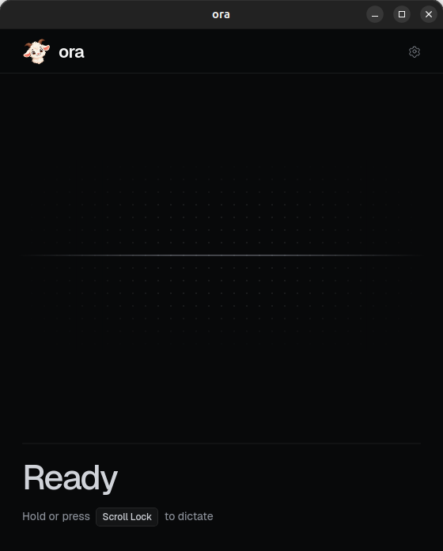

<p align="center">
    
</p>

&nbsp;

<p align="center">
    A desktop app that types what you say into whichever app has focus.
</p>

<p align="center">
    <a href="https://github.com/stratusadv/ora/actions/workflows/test.yml"></a>
    <a href="https://github.com/stratusadv/ora/releases/latest"></a>
    <a href="https://github.com/stratusadv/ora/releases/latest"></a>
    <a href="LICENSE"></a>
</p>

<p align="center">
    
</p>

## Overview

ora is a dictation app that waits in the tray. A shortcut starts the microphone, the Stratus speech model turns the recording into text, and ora pastes the text into the app that has focus. The app is useful for anyone who would rather say a paragraph than type it, in a chat, an email, a ticket, or a terminal. It is the sibling of [scribe](https://github.com/stratusadv/scribe) and is built the same way, and the audio goes only to the company's own API.

## How It Works

A dictation runs in four steps, and the window shows whether ora is idle, listening, or transcribing.

- **Recording**: The default shortcut is `Ctrl` + `Shift` + `Space`, and a short cue plays as the microphone starts and stops. The shortcut mode decides how the keys behave. *Hold or toggle* treats a press shorter than 400 ms as a tap that starts and stops a recording and a longer one as push to talk, while *Push to talk* and *Toggle* each keep to one of the two.
- **Transcription**: The recording goes to the transcription API with the custom vocabulary as spelling hints. A recording with no speech in it is dropped with a notice rather than pasted.
- **Cleanup**: The *Spelling & grammar cleanup* switch, on by default, sends the transcript to the LLM to add punctuation and capitalization and to drop filler sounds such as um and uh. The model is told to keep every other word as it was, and a reply whose word count strays too far from the transcript is thrown away. The raw transcript is pasted with a notice instead, and a failed request falls back the same way.
- **Paste**: The text goes onto the clipboard and ora presses the paste keys in the app that has focus. The text stays on the clipboard afterwards, so a paste that lands in the wrong window is one `Ctrl` + `V` away. A desktop that blocks simulated input leaves the text there with a notice to paste it by hand.

## Install

Each installer is on the [download page](https://stratusadv.github.io/ora/) and on the [latest release](https://github.com/stratusadv/ora/releases/latest). An installed copy checks for a new version at each launch and offers to install it, so the installer is only needed once.

| Platform | Installer | Notes |
|----------|-----------|-------|
| Windows 10 and 11 | `ora_<version>_x64-setup.exe` | SmartScreen may warn because the installer is unsigned. Choose *More info*, then *Run anyway*. WebView2 installs itself if it is missing. |
| Ubuntu and Debian | `ora_<version>_amd64.deb` | The package installs with `sudo apt install ./ora_<version>_amd64.deb`. |
| Fedora | `ora-<version>-1.x86_64.rpm` | The package installs with `sudo dnf install ./ora-<version>-1.x86_64.rpm`. |
| Arch, Omarchy, and any other Linux | `ora_<version>_amd64.AppImage` | The AppImage runs after `chmod +x` and needs no packages. |

## Setup

The app talks to two API services behind a single address, one for transcription and one for the cleanup LLM. A build made from a checkout whose `.env` holds `ORA_API_HOST`, `ORA_API_KEY_TRANSCRIPTION`, and `ORA_API_KEY_LLM` needs no setup at all. Any other build asks once for whichever of the API address, the transcription key, and the LLM key it lacks. A value entered in Settings always wins over the built-in one, so a key can be replaced without a new build.

The Settings page sits behind the gear. It also holds the microphone, the shortcut and its mode, the paste keystroke, the custom vocabulary, the audio cues, launch at startup, and the cleanup model and how long it thinks before writing.

## Linux

- **Wayland**: ora reads the keyboard directly, which needs the `input` group. Run `sudo usermod -aG input $USER` once, then sign out and back in.
- **GNOME and KDE**: The desktop asks once for permission to press the paste keys.
- **GNOME without a tray**: ora runs without a tray icon, and opening it again from the app menu shows the window.
- **Terminals and Dvorak**: The *Paste keystroke* setting switches to `Ctrl` + `Shift` + `V` or `Shift` + `Insert`.

## Build

The frontend is Vue 3, built with Vite and Bun, and the shell is Tauri 2 with the audio, the shortcut, the paste, and the API work in Rust. A development build runs with hot reload, and a production build produces the installers for the current platform.

```
just install
just dev
just build
```

A production build warns when one of the three `ORA_API_*` variables is empty, because that build ships without it, and when `src-tauri/tauri.conf.json` still holds the updater placeholder, because that build cannot update itself.

## Test

There are three layers of tests, and the `test` workflow on GitHub Actions runs each of them on every push to `main` and every pull request.

- **Rust unit tests**: The backend modules carry their own tests for the settings, the shortcut, the audio, the cleanup checks, the paste keys on each desktop, and the HTTP layer. They run with `cargo test` in `src-tauri`, on Linux and on Windows.
- **Frontend unit tests**: Vitest runs the components, composables, and libraries in happy-dom, with the IPC layer mocked. They run with `bun run test`.
- **End-to-end tests**: `tauri-driver` drives a debug build of the real app under Xvfb against a stub API server, through the first run, the settings, and a relaunch. The build sets the three `ORA_API_*` variables empty, which a set variable does even over `.env`, so the run starts at the setup screen. They run with `just e2e` on Linux, and need `cargo install tauri-driver --locked` and the WebKitGTK WebDriver, packaged as `webkit2gtk-driver` on Ubuntu 24.04 and `webkitgtk-webdriver` on 26.04.

The `verify` recipe runs the formatter check, Clippy, the Rust tests, tigerstyle, the type check, the linter, and the frontend tests in one pass.

```
just verify
```

## Release

A push of a `v*` tag builds the Windows installer and the Linux packages on GitHub Actions, signs them, and publishes a release with the installers, their signatures, and the `latest.json` the updater reads. A release builds in only the API address, from the `ORA_API_HOST` repository variable, because anyone with the installer could read a key out of the binary.

The signing key is generated once. The private key never enters the repository, and an installed copy only ever accepts updates signed by it, so back it up.

```
bun tauri signer generate -w ~/.tauri/ora.key
```

The public key lives in `plugins.updater.pubkey` in `src-tauri/tauri.conf.json`. The private key and its password live in the repository's Actions secrets as `TAURI_SIGNING_PRIVATE_KEY` and `TAURI_SIGNING_PRIVATE_KEY_PASSWORD`.

Each release bumps `version` in `src-tauri/tauri.conf.json`, `src-tauri/Cargo.toml`, and `package.json` in one commit. The tag then triggers the build:

```
git tag v0.1.0
git push origin v0.1.0
```

A local build signs the same way, with the key contents in the environment:

```
TAURI_SIGNING_PRIVATE_KEY="$(cat ~/.tauri/ora.key)" \
TAURI_SIGNING_PRIVATE_KEY_PASSWORD=... \
just build
```
